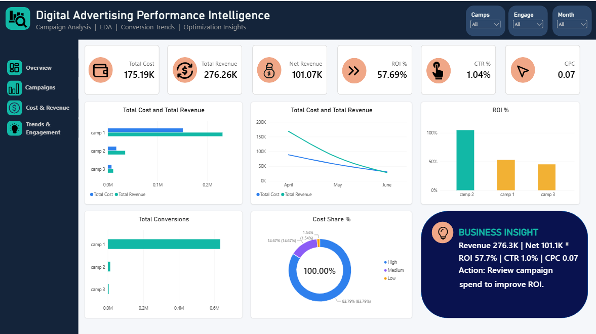
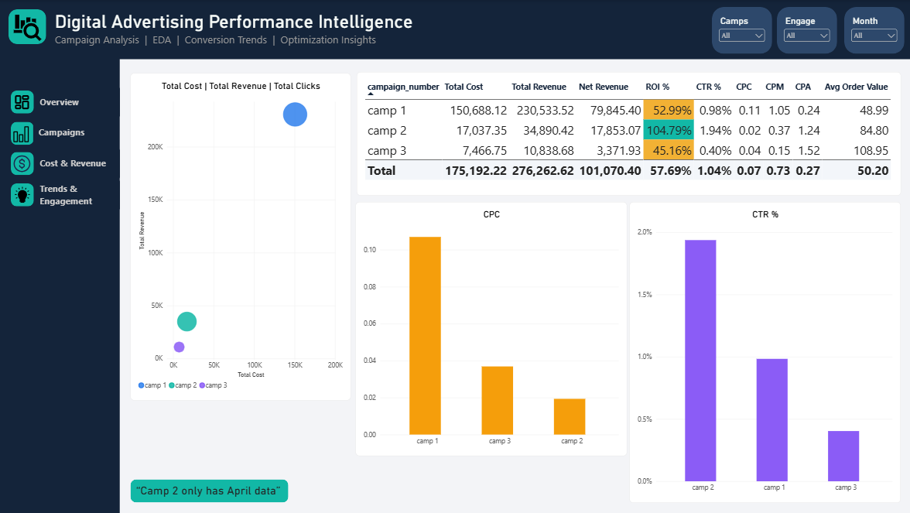
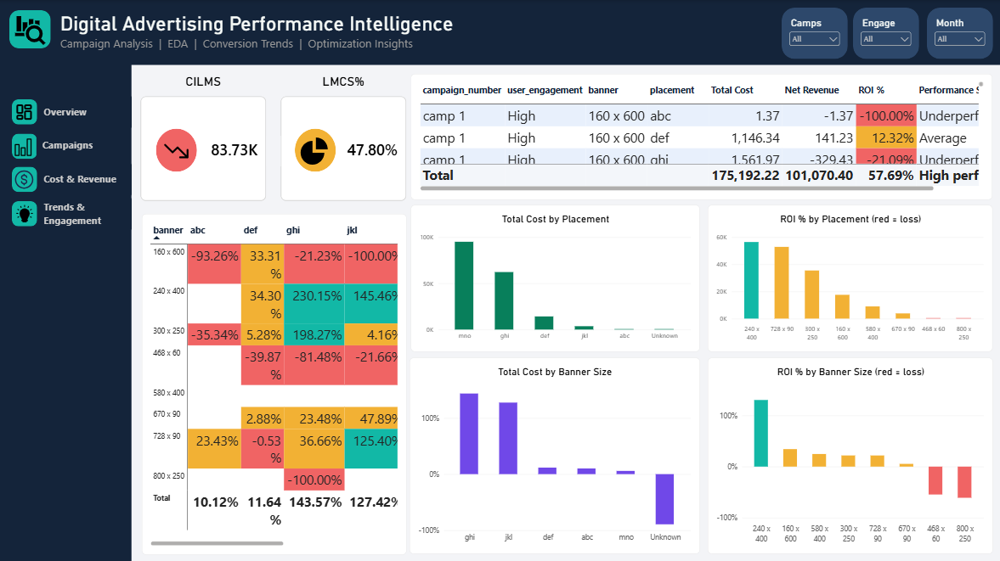
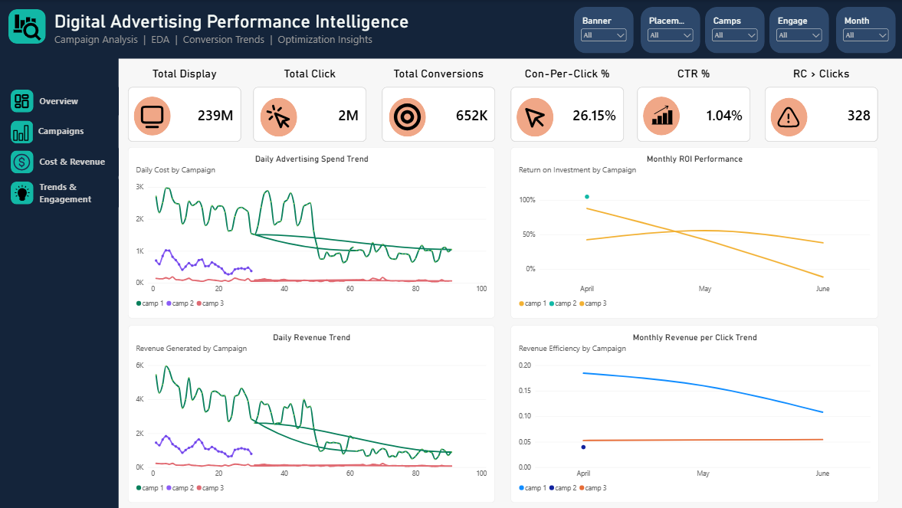

# 📊 Digital Advertising Performance Intelligence

> **An end-to-end data analytics project using Python, Exploratory Data Analysis (EDA), and Power BI.**  
> Explore campaign performance, advertising costs, revenue, ROI, click-through rate, audience engagement, banner sizes, and placements.


---

## 👋 About the Project

**Digital Advertising Performance Intelligence** investigates how advertising campaigns perform over time and across audience-engagement levels, banner sizes, and placements. The project combines Python-based analysis with a multi-page Power BI dashboard to turn raw advertising data into practical business insights.

The workflow covers data inspection, cleaning, exploratory analysis, deeper segment analysis, and dashboard storytelling. The goal is not just to report totals, but to identify where spend is concentrated, which segments are more efficient, and where performance needs investigation.

## 🎯 Project Objectives

- 🧹 Inspect and clean the raw dataset while preserving useful records.
- 📈 Compare campaign cost, revenue, net revenue, ROI, CTR, CPC, CPM, and CPA.
- 🗓️ Explore changes across April, May, and June.
- 🎯 Compare performance by user engagement, banner size, and placement.
- 🔎 Identify profitable and loss-making combinations of campaign and advertising attributes.
- ⚠️ Flag unusual conversion/display patterns for further validation.
- 📊 Present findings through an interactive Power BI report.

## 🧰 Tools & Technologies

| Tool | How it is used |
|---|---|
| Python | Data preparation and analysis |
| Pandas, NumPy | Data cleaning, aggregation, metric calculations |
| Matplotlib, Seaborn | EDA charts and visual analysis |
| Jupyter Notebook | Reproducible analysis workflow |
| Power BI | Interactive report, KPI cards, filters, and campaign comparisons |
| DAX | Measures and dynamic report calculations |

## 🗂️ Repository Structure

```text
Digital-Advertising-Performance-Intelligence/
├── README.md
├── data/
│   ├── raw/
│   │   └── online_advertising_performance_data.csv
│   └── processed/
│       └── advertising_cleaned.csv
├── notebooks/
│   ├── 01_data_inspection.ipynb
│   ├── 02_data_cleaning.ipynb
│   ├── 03_exploratory_analysis.ipynb
│   └── 04_advanced_analysis.ipynb
├── powerbi/
│   └── advertising_dashboard.pbix
├── screenshots/
│   ├── overview.png
│   ├── campaigns.png
│   ├── cost_revenue.png
│   └── trends_engagement.png
└── requirements.txt
```

> 📝 **Note:** The structure and filenames above are suggested names for the GitHub repository. Match them to the files you upload. The cleaned dataset is generated by the data-cleaning notebook and saved to `data/processed/advertising_cleaned.csv`.

## 🔬 Analysis Workflow

### 1. 🔍 Data Inspection
Notebook: `01_data_inspection.ipynb`

- Inspect dataset shape, columns, data types, and data quality.
- Review missing values, duplicates, and numeric distributions.
- Understand the fields before making cleaning decisions.

### 2. 🧹 Data Cleaning
Notebook: `02_data_cleaning.ipynb`

- Remove fully empty columns.
- Remove **5 exact duplicate rows**.
- Fill **413 missing placement values** with `Unknown` rather than deleting rows that contain valid advertising activity.
- Standardize text fields and set appropriate data types.
- Add flags for suspicious patterns instead of silently deleting those records.
- Check outliers and retain high-volume records when they appear internally consistent.
- Reconcile important totals and save the cleaned dataset.

**Cleaning summary:** raw data contained **15,408 rows**; the cleaned data contains **15,403 rows**. The notebook reports that the raw file remains unchanged.

### 3. 📊 Exploratory Data Analysis
Notebook: `03_exploratory_analysis.ipynb`

- Overall KPI and campaign scorecards.
- Monthly and daily cost/revenue trends.
- Engagement-level performance.
- Banner-size and placement comparisons.
- ROI heatmap by banner and placement.
- Distribution and outlier exploration.

### 4. 🧠 Advanced Analysis
Notebook: `04_advanced_analysis.ipynb`

- Campaign scorecard and an April-only comparison.
- Segment-level profitability analysis.
- Cost-versus-revenue comparisons against a break-even line.
- Engagement and placement efficiency analysis.
- Spearman correlation checks.
- Daily loss patterns and unusual conversion counts.
- Recommendations grounded in observed results.

**This project uses descriptive and diagnostic analytics; it does not claim to train a machine-learning model.**

## 📸 Power BI Dashboard

The Power BI report is organized into four pages:

1. **Overview** — headline KPIs, campaign comparisons, ROI, cost share, and a business-insight panel.
2. **Campaigns** — campaign scorecard, cost/revenue relationship, CPC, and CTR comparisons.
3. **Cost & Revenue** — cost in loss-making segments, loss-making cost share, and ROI by placement/banner attributes.
4. **Trends & Engagement** — displays, clicks, conversions, CTR, daily spend/revenue trends, monthly ROI, and revenue per click.

The report includes slicers for campaign, month, engagement, banner, and placement where relevant.

> 🖼️ Add the four report-page screenshots to the `screenshots/` folder and update the image links below to match your final filenames.

### Dashboard Preview

| Overview | Campaigns |
|---|---|
|  |  |

| Cost & Revenue | Trends & Engagement |
|---|---|
|  |  |

## 💡 Key Findings

The findings below are based on the analysis in the notebooks. The reporting period is **April–June**; the source data does not specify a year.

- 💰 **Overall portfolio ROI is approximately +57.7%**: total revenue is about **276.3K** against total cost of about **175.2K**, giving net revenue of about **101.1K**.
- 📣 **Camp 1 dominates spend**, accounting for approximately **86% of total cost** (about 150.7K). Its scale means that changes in this campaign strongly affect the overall result.
- 🏆 **Camp 2 leads on the observed efficiency metrics**—approximately **+104.8% ROI**, **1.94% CTR**, and **0.02 CPC**—but it has data for **April only**, so its result needs validation over a longer period.
- ⚠️ **Camp 1 weakens over time**: its ROI falls from about **+88% in April** to **+42% in May** and around **−11% in June**.
- 🎯 **Medium-engagement traffic is more efficient in the observed data**, with ROI around **+129%**, while accounting for roughly **15% of spend**.
- 🔎 **Placement performance varies considerably**: `ghi` and `jkl` show strong overall ROI, while `mno` receives the largest share of spend but returns only around **+6% ROI** overall.
- 🧩 **Losses are concentrated in particular segments**: the advanced analysis identifies substantial loss-making spend, especially among Camp 1 / High-engagement combinations involving `mno` and `def`.
- 🚩 **328 rows have more post-click conversions than clicks**. This needs validation with the data owner before interpreting conversion-based metrics literally.

Values are rounded for readability and may vary slightly by display format.

## 📐 Metric Definitions

| Metric | Formula | Interpretation |
|---|---|---|
| Net Revenue | Revenue − Cost | Amount remaining after advertising cost |
| ROI (%) | `(Revenue − Cost) / Cost × 100` | Return relative to cost, assuming revenue and cost use the same currency |
| CTR (%) | `Clicks / Displays × 100` | Share of displays that generated clicks |
| CPC | `Cost / Clicks` | Average cost per click |
| CPM | `Cost / Displays × 1,000` | Cost per thousand displays |
| CPA | `Cost / Post-click conversions` | Cost per recorded conversion |
| Conversions per Click (%) | `Post-click conversions / Clicks × 100` | Recorded conversions relative to clicks; interpret cautiously because some rows have more conversions than clicks |

Ratios are calculated from **group totals**, rather than taking a simple average of row-level ratios. `post_click_sales_amount` is kept separate from `revenue` because the source does not define how these fields relate; this project does not treat that field as profit or use it to calculate ROAS.

## 🚀 Business Recommendations

1. **Review Camp 1's high-spend placements**, particularly `mno` and `def`, and test a measured budget shift toward stronger segments such as `ghi` and `jkl`.
2. **Investigate Camp 1's June decline**: CPC rises while revenue per click falls. Review bidding, audience mix, creative fatigue, and tracking changes with the campaign owner.
3. **Validate Camp 2 over a longer period** before scaling its budget based on April alone.
4. **Run controlled tests with Medium-engagement segments** that already show stronger ROI; increase spend gradually and monitor results.
5. **Re-test or limit Camp 3 / High-engagement segments** where the analysis indicates negative returns.
6. **Audit conversion tracking and metric definitions**, especially rows where conversions exceed clicks and the meaning of `revenue` versus `post_click_sales_amount`.

These are data-informed hypotheses to test, not proof that changing spend alone will cause the same results at a larger scale.

## ⚠️ Limitations & Data Cautions

- The dataset covers April–June but contains **no year**, so year-over-year or seasonal conclusions cannot be made.
- Camp 2 has April-only data; cross-month campaign comparisons are not like-for-like.
- ROI assumes `revenue` and `cost` are comparable and expressed in the same currency.
- Some rows have more recorded conversions than clicks; conversion metrics require tracking validation.
- Segment rankings use a minimum-cost threshold in the advanced analysis to reduce instability in small samples.
- Correlation indicates variables that move together; it does **not** establish causation.
- The results describe the supplied dataset and should be validated against business definitions before real budget decisions.

## ⚙️ How to Run the Analysis

1. Clone or download this repository.
2. Install Python and Jupyter Notebook.
3. Install the libraries used by the notebooks:

   ```bash
   pip install pandas numpy matplotlib seaborn jupyter
   ```

4. Keep the folder structure consistent with the relative paths used in the notebooks.
5. Run the notebooks in this order:
   - `01_data_inspection.ipynb`
   - `02_data_cleaning.ipynb`
   - `03_exploratory_analysis.ipynb`
   - `04_advanced_analysis.ipynb`
6. Open `powerbi/advertising_dashboard.pbix` in **Power BI Desktop** to explore the report.

## 👨‍💻 Project Author

**Mohd Fuzail Salmani**  
Aspiring AI Engineer | Data Analytics | Python • SQL • Power BI

- 💼 LinkedIn: [Connect with me](https://www.linkedin.com/in/fuzailsalmani/)

## 🤝 Let's Connect & Discuss!

If you find this project useful:

- ⭐ Star this repository.
- 💬 Open an issue or share suggestions for improving the analysis.
- 🔁 Share it with someone interested in Python, EDA, or Power BI.
- 🤝 Connect with me on LinkedIn to discuss data analytics, dashboards, and AI engineering.

**What would you investigate first: the June ROI decline, Camp 1's high spend, or the conversion-tracking anomalies?** 💭

---

*Built with curiosity, data, and a focus on actionable insights. 🚀*
